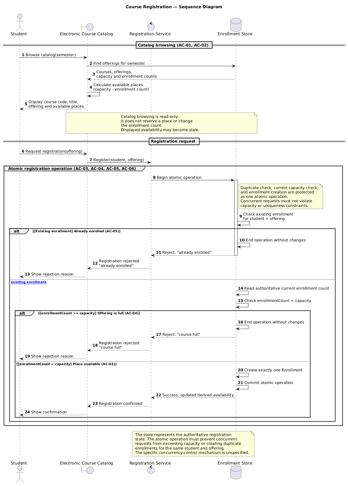
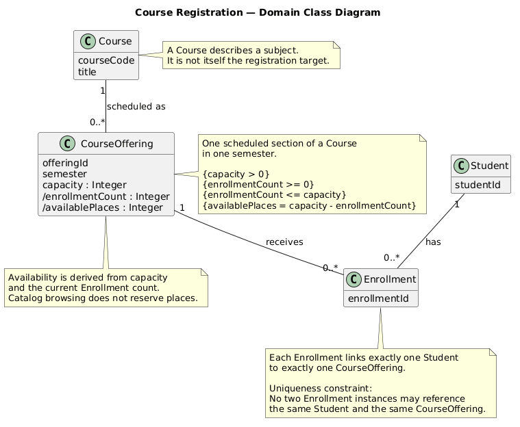
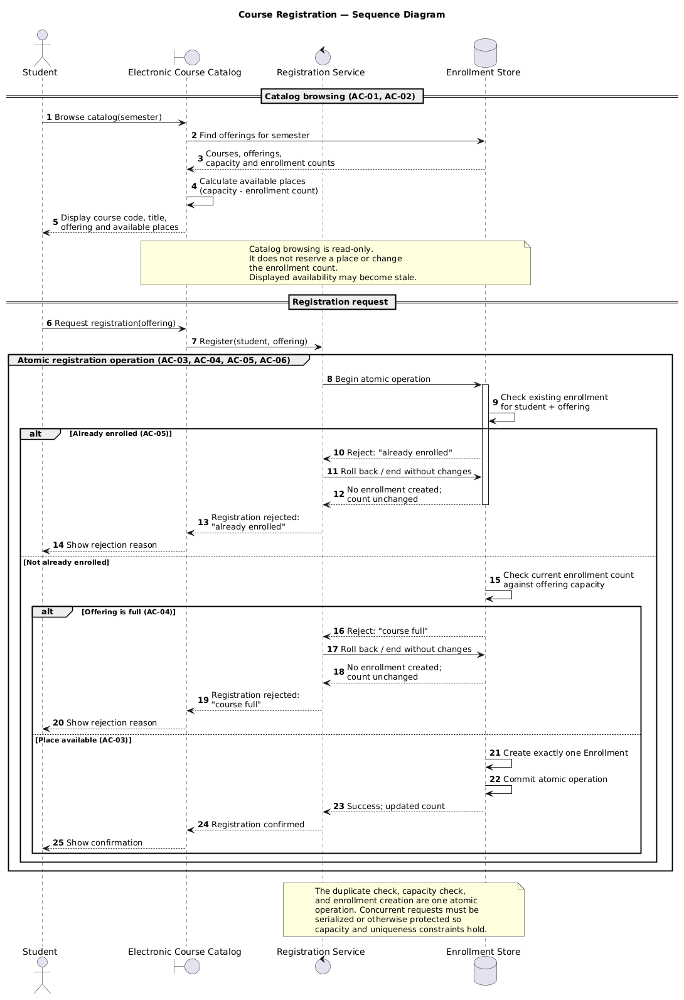

# SIS #02 — AI-Assisted UML Modeling: University Course Registration

## 1. Scope and assumptions

**Scope:** A student browses a course catalog, selects a specific course offering, and requests registration. The system checks the current capacity and whether the student is already enrolled, creates an Enrollment on success, or rejects with a clear reason. Payments, prerequisites, timetable clashes, waiting lists and cancellation are out of scope.

**Assumptions:**

1. The student is signed in, and the selected CourseOffering exists with a positive capacity.
2. The catalog view displays available places derived from the current count of active Enrollments.

## 2. User stories and acceptance criteria

### US-01 — Browse the course catalog

**US-01:** As a student, I want to browse the electronic course catalog for a selected semester, so that I can review course details, scheduled offerings, and available places before requesting registration.

- **AC-01** (R1): Given the student is signed in and course offerings exist for the selected semester, When the student views the electronic course catalog for that semester, Then the catalog displays each relevant course's code, title, offering, and available places for that semester.
- **AC-02** (R1, R2): Given the student views an offering whose capacity is a positive whole number, When the catalog displays the available places, Then the displayed availability is derived from the offering's capacity and current enrollment count, and viewing the catalog does not reserve a place or change the enrollment count.

### US-02 — Register for a course offering

**US-02:** As a student, I want to register for a specific course offering, so that I can enroll in the scheduled section I have selected.

- **AC-03** (R2, R3, R4): Given the student is not enrolled in the selected offering and the offering has available places, When the student requests registration and the current availability and duplicate-enrollment checks pass, Then the system atomically creates exactly one Enrollment linking the student to that specific offering, updates availability to reflect the new enrollment, and returns a registration confirmation.
- **AC-06** (R2, R4, R5): Given an offering has only one place remaining and multiple students request registration, When their registration requests are processed concurrently, Then the final availability check and enrollment creation are performed as one atomic operation, no more than one additional Enrollment is created, the offering's capacity is never exceeded, and any rejected request receives the applicable explanation "course full" with no enrollment created and no change to the enrollment count caused by that rejected request.

### US-03 — Receive a registration rejection

**US-03:** As a student, I want to receive a clear explanation when registration is rejected because an offering is full or I am already enrolled, so that I understand why my registration request was unsuccessful.

- **AC-04** (R2, R5): Given the selected offering has reached its capacity when registration is processed, When the student requests registration, Then the system rejects the request with the explanation "course full", creates no Enrollment, and leaves the enrollment count unchanged.
- **AC-05** (R3, R5): Given the student already has an Enrollment in the selected offering, When the student requests registration for that same offering again, Then the system rejects the request with the explanation "already enrolled", creates no Enrollment, and leaves the enrollment count unchanged.

## 3. Sequence diagram

**Participants:** Student, Electronic Course Catalog, Registration Service, Enrollment Store. Student is the actor. The Catalog, Service, and Store represent the layers of the system handling the request.

**Atomic operation:** The duplicate check, the capacity check and the creation of the Enrollment are grouped in a `group Atomic registration operation` and noted as atomic. The catalog view is intentionally read-only and does not reserve a place.

**Where the Enrollment is created:** The message `Store -> Store: Create exactly one Enrollment` inside the atomic group.

**Technical lifelines:** The `Catalog`, `Service`, and `Store` are technical components, not domain classes. They are modeled in the sequence diagram to show the flow, while the class diagram models the domain concepts.

## 4. Class diagram

| Association | Read left to right | Read right to left |
| --- | --- | --- |
| Student — Enrollment | One student has 0..* enrollments. | Each enrollment belongs to exactly one student. |
| CourseOffering — Enrollment | One offering receives 0..* enrollments. | Each enrollment targets exactly one offering. |
| Course — CourseOffering | One course is scheduled as 0..* offerings. | Each offering belongs to exactly one course. |

**How an Enrollment links a student to an offering:** Each Enrollment object has exactly one Student and exactly one CourseOffering, represented by the multiplicities `1` at both ends of the associations.

**Capacity constraint:** Stated in a note on CourseOffering: `{enrollmentCount <= capacity}`. Multiplicity alone cannot express a numerical limit on the number of associated objects.

**Uniqueness constraint:** Stated in a note on Enrollment: `Uniqueness constraint: No two Enrollment instances may reference the same Student and the same CourseOffering.` Multiplicity alone cannot express this.

## 5. Traceability

| Rule and criterion | Model evidence | Validation case |
| --- | --- | --- |
| R1 + AC-01, AC-02 | Catalog browsing messages, Course/CourseOffering attributes | Extra check: catalog shows code, title and places. No T case for R1. |
| R2 + AC-03, AC-04, AC-06 | `Read authoritative current enrollment count`, `Check enrollmentCount < capacity`, atomic group | T2, T3 |
| R3 + AC-05 | `Check existing enrollment for student + offering`, uniqueness note | T4 |
| R4 + AC-03, AC-06 | `Create exactly one Enrollment`, `Registration confirmed` | T1, T2 |
| R5 + AC-04, AC-05 | `Reject: "course full"`, `Reject: "already enrolled"`, no state change | T3, T4 |

## 6. Walkthroughs

| Case | Observed path and state change | Judgment and evidence |
| --- | --- | --- |
| T1. Available | Start: capacity 2, enrolled 0. Request -> `Check existing enrollment` (none) -> `Check enrollmentCount < capacity` (true) -> `Create exactly one Enrollment` -> commit. Count becomes 1. | Pass. Location: `Create exactly one Enrollment` in atomic group. |
| T2. Last place | Start: capacity 2, enrolled 1. Request -> `Check existing` -> `Check count < capacity` (true) -> `Create Enrollment` -> commit. Count becomes 2. | Pass. Location: `Create exactly one Enrollment` in atomic group. |
| T3. Full | Start: catalog shows a place, current count 2 of 2. Request -> `Check existing` -> `Check count < capacity` (false) -> `End operation without changes` -> reject "course full". Count stays 2. | Pass. Location: `alt [enrollmentCount >= capacity] Offering is full`. |
| T4. Duplicate | Start: capacity 2, enrolled 1, same student. Request -> `Check existing` (already enrolled) -> `End operation without changes` -> reject "already enrolled". Count stays 1. | Pass. Location: `alt [Existing enrollment] Already enrolled`. |

## 7. Review decisions

| AI suggestion or model element | Decision | Reason | Rule |
| --- | --- | --- | --- |
| Original rejection returned before transaction completion. | Modified | I moved the `End operation without changes` step to happen *before* returning the rejection to the caller, ensuring the transaction boundary is clear. | R5 |
| Original concurrent protection was not explicit. | Accepted | I kept the `group Atomic registration operation` and added notes clarifying that the store represents the authoritative state and protects against race conditions. | R2, R4 |
| Original class diagram syntax was single-line. | Accepted | I reformatted the PlantUML class attributes to standard multiline syntax to ensure proper rendering. | R1, R2 |

## 8. Modeling explanation

The class diagram models the static domain: Student, Course, CourseOffering, and Enrollment. It shows that a Student has many Enrollments, and a CourseOffering receives many Enrollments, but each Enrollment links exactly one Student and one CourseOffering. Two constraints are stated separately as notes because multiplicity cannot express them: the capacity limit (R2) and the uniqueness of the student-offering pair (R3). By keeping these as notes, the diagram explicitly communicates the business rules to a developer without overcomplicating the visual structure with complex OCL constraints.

The sequence diagram models the dynamic interaction. It uses boundary/control/database lifelines to show the architecture: the Catalog (UI), the Registration Service (logic), and the Enrollment Store (persistence). The critical design choice is the `group Atomic registration operation`. By grouping the duplicate check, the capacity check, and the creation inside this group, the diagram enforces that no other request can interleave and steal the last place. The catalog view is modeled as a read-only interaction to make it clear that browsing does not reserve a place.

An activity diagram could also help here. While a sequence diagram shows the chronological order of messages between objects, an activity diagram would show the workflow and decision points more clearly to a non-technical stakeholder, such as the branch for "already enrolled" versus "course full". This would make the business logic accessible to product managers or department heads who might not understand UML sequence notation.

## 9. Reflection

AI helped most in generating the initial PlantUML structure and suggesting the use of stereotypes (`boundary`, `control`, `database`), which made the sequence diagram look professional. It also correctly identified the need for an atomic block, which is a subtle requirement that I might have initially overlooked when focusing on the business logic.

One decision I made myself was to refine the AI's constraints. The AI initially put the capacity and uniqueness rules in the class diagram notes, which is correct, but I made sure they were formatted clearly so a developer could read them as exact business rules. I also caught the syntax error in the class diagram during rendering, which forced me to manually reformat the PlantUML code into a multiline structure.

A remaining limitation of my model is that it does not show the actual locking mechanism (e.g., a database row lock) used to enforce atomicity. The model states that the operation must be atomic, but the implementation details are abstracted away. The exact concurrency control mechanism would need to be defined in the implementation phase.

## 10. Appendix A — Before AI

**Scope:** A student browses a course catalog, selects a course offering, and requests registration. The system checks capacity and duplicate enrollment, creates an Enrollment on success, or rejects with a clear reason.

**Initial assumptions:**

1. The student is signed in and the selected offering exists.
2. The catalog shows available places based on the current enrollment count.

## 11. Appendix B — AI exchanges

### B1 — Requirements (Prompt A)

- **Tool:** ChatGPT
- **Model:** not displayed
- **Date:** 2026-10-18
- **Purpose:** draft 3 user stories and 6 acceptance criteria

**Prompt:**

~~~~text
Act as a requirements analyst. Use only this course registration scenario and rules R1–R5: A student browses an electronic course catalog, chooses a course offering and requests registration. Each offering has a limited number of places. A Course describes a subject. A CourseOffering is one scheduled section in one semester. Registration always targets a specific offering. Assume that the student is signed in, the selected offering exists, and its capacity is a positive whole number. Exclude payments, prerequisites, timetable clashes, waiting lists and cancellation. Rules: R1. Catalog: Show the course code, title, offering and available places for one semester. R2. Capacity: Recheck current availability when registering. Enrollment must never exceed the offering's capacity. R3. Duplicates: A student may have at most one enrollment in the same offering. Reject a repeat request. R4. Success: Create exactly one Enrollment linking the student and offering, update availability and return a confirmation. R5. Rejection: Explain "course full" or "already enrolled". Create no enrollment and leave the enrollment count unchanged. A catalog view does not reserve a place. Model the final checks and enrollment creation as one atomic operation. My initial assumptions are 1. The student is signed in, and the selected CourseOffering exists with a positive capacity. 2. The catalog view displays available places derived from the current count of active Enrollments.
Draft 3 user stories and 2 Given / When / Then acceptance criteria for each. Use IDs US-01 to US-03 and AC-01 to AC-06. Map each criterion to rule IDs.
Cover normal and rejection behavior. List uncertainty separately. Do not add excluded features or invent university policies.
~~~~

**Response:**

~~~~text
Course Registration — User Stories and Acceptance Criteria

1. User stories
US-01 — Browse the course catalog
As a student, I want to browse the electronic course catalog for a selected semester, so that I can review course details, scheduled offerings, and available places before requesting registration. (Rules: R1)
US-02 — Register for a course offering
As a student, I want to register for a specific course offering, so that I can enroll in the scheduled section I have selected. (Rules: R2, R3, R4)
US-03 — Receive a registration rejection when enrollment is not allowed
As a student, I want to receive a clear explanation when registration is rejected because an offering is full or I am already enrolled, so that I understand why my registration request was unsuccessful. (Rules: R2, R3, R5)

2. Acceptance criteria
AC-01 (R1): Given the student is signed in and course offerings exist for the selected semester, When the student views the electronic course catalog for that semester, Then the catalog displays each relevant course's code, title, offering, and available places for that semester.
AC-02 (R1, R2): Given the student views an offering whose capacity is a positive whole number, When the catalog displays the available places, Then the displayed availability is derived from the offering's capacity and current enrollment count, and viewing the catalog does not reserve a place or change the enrollment count.
AC-03 (R2, R3, R4): Given the student is not enrolled in the selected offering and the offering has available places, When the student requests registration and the current availability and duplicate-enrollment checks pass, Then the system atomically creates exactly one Enrollment linking the student to that specific offering, updates availability to reflect the new enrollment, and returns a registration confirmation.
AC-04 (R2, R5): Given the selected offering has reached its capacity when registration is processed, When the student requests registration, Then the system rejects the request with the explanation "course full", creates no Enrollment, and leaves the enrollment count unchanged.
AC-05 (R3, R5): Given the student already has an Enrollment in the selected offering, When the student requests registration for that same offering again, Then the system rejects the request with the explanation "already enrolled", creates no Enrollment, and leaves the enrollment count unchanged.
AC-06 (R2, R4, R5): Given an offering has only one place remaining and multiple students request registration, When their registration requests are processed concurrently, Then the final availability check and enrollment creation are performed as one atomic operation, no more than one additional Enrollment is created, the offering's capacity is never exceeded, and any rejected request receives the applicable explanation "course full" with no enrollment created and no change to the enrollment count caused by that rejected request.
~~~~

### B2 — UML drafts (Prompt B)

- **Tool:** ChatGPT
- **Model:** not displayed
- **Date:** 2026-10-18
- **Purpose:** draft the sequence and class diagrams

**Prompt:**

~~~~text
Using my approved scenario, R1–R5, stories and criteria below, return separate PlantUML code blocks for a sequence diagram and a domain class diagram.
Sequence: include catalog browsing and guarded success, full-course and duplicate outcomes. Model final checks and creation as one atomic operation.
Class: show domain concepts, useful attributes and multiplicities. State the capacity and uniqueness constraints. Explain assumptions and any technical lifelines.

US-01: As a student, I want to browse the electronic course catalog for a selected semester, so that I can review course details, scheduled offerings, and available places before requesting registration.
AC-01 (R1): Given the student is signed in and course offerings exist for the selected semester, When the student views the electronic course catalog for that semester, Then the catalog displays each relevant course's code, title, offering, and available places for that semester.
AC-02 (R1, R2): Given the student views an offering whose capacity is a positive whole number, When the catalog displays the available places, Then the displayed availability is derived from the offering's capacity and current enrollment count, and viewing the catalog does not reserve a place or change the enrollment count.

US-02: As a student, I want to register for a specific course offering, so that I can enroll in the scheduled section I have selected.
AC-03 (R2, R3, R4): Given the student is not enrolled in the selected offering and the offering has available places, When the student requests registration and the current availability and duplicate-enrollment checks pass, Then the system atomically creates exactly one Enrollment linking the student to that specific offering, updates availability to reflect the new enrollment, and returns a registration confirmation.
AC-06 (R2, R4, R5): Given an offering has only one place remaining and multiple students request registration, When their registration requests are processed concurrently, Then the final availability check and enrollment creation are performed as one atomic operation, no more than one additional Enrollment is created, the offering's capacity is never exceeded, and any rejected request receives the applicable explanation "course full" with no enrollment created and no change to the enrollment count caused by that rejected request.

US-03: As a student, I want to receive a clear explanation when registration is rejected because an offering is full or I am already enrolled, so that I understand why my registration request was unsuccessful.
AC-04 (R2, R5): Given the selected offering has reached its capacity when registration is processed, When the student requests registration, Then the system rejects the request with the explanation "course full", creates no Enrollment, and leaves the enrollment count unchanged.
AC-05 (R3, R5): Given the student already has an Enrollment in the selected offering, When the student requests registration for that same offering again, Then the system rejects the request with the explanation "already enrolled", creates no Enrollment, and leaves the enrollment count unchanged.
~~~~

**Response:**

~~~~text
The diagrams below use the approved stories and acceptance criteria. The sequence diagram separates read-only catalog browsing from registration, and models the duplicate check, capacity check, and enrollment creation as a single atomic operation. The class diagram represents Course, CourseOffering, Student, and Enrollment as domain concepts, with explicit multiplicities and constraints.

[Sequence Diagram]
@startuml
title Course Registration — Sequence Diagram
autonumber
actor Student
boundary "Electronic Course Catalog" as Catalog
control "Registration Service" as Service
database "Enrollment Store" as Store
== Catalog browsing (AC-01, AC-02) ==
Student -> Catalog: Browse catalog(semester)
Catalog -> Store: Find offerings for semester
Store --> Catalog: Courses, offerings,\ncapacity and enrollment counts
Catalog -> Catalog: Calculate available places\n(capacity - enrollment count)
Catalog --> Student: Display course code, title,\noffering and available places
note over Catalog, Store
Catalog browsing is read-only.
It does not reserve a place or change
the enrollment count.
Displayed availability may become stale.
end note
== Registration request ==
Student -> Catalog: Request registration(offering)
Catalog -> Service: Register(student, offering)
group Atomic registration operation (AC-03, AC-04, AC-05, AC-06)
    Service -> Store: Begin atomic operation
    activate Store
    Store -> Store: Check existing enrollment\nfor student + offering
    alt Already enrolled (AC-05)
        Store --> Service: Reject: "already enrolled"
        Service -> Store: Roll back / end without changes
        Store --> Service: No enrollment created;\ncount unchanged
        deactivate Store
        Service --> Catalog: Registration rejected:\n"already enrolled"
        Catalog --> Student: Show rejection reason
    else Not already enrolled
        Store -> Store: Check current enrollment count\nagainst offering capacity
        alt Offering is full (AC-04)
            Store --> Service: Reject: "course full"
            Service -> Store: Roll back / end without changes
            Store --> Service: No enrollment created;\ncount unchanged
            deactivate Store
            Service --> Catalog: Registration rejected:\n"course full"
            Catalog --> Student: Show rejection reason
        else Place available (AC-03)
            Store -> Store: Create exactly one Enrollment
            Store -> Store: Commit atomic operation
            Store --> Service: Success; updated count
            deactivate Store
            Service --> Catalog: Registration confirmed
            Catalog --> Student: Show confirmation
        end
    end
end
note over Service, Store
The duplicate check, capacity check,
and enrollment creation are one atomic
operation. Concurrent requests must be
serialized or otherwise protected so
capacity and uniqueness constraints hold.
end note
@enduml

[Class Diagram]
@startuml
title Course Registration — Domain Class Diagram
hide empty methods
skinparam classAttributeIconSize 0
class Student { studentId }
class Course { courseCode title }
class CourseOffering { offeringId semester capacity : Integer /enrollmentCount : Integer /availablePlaces : Integer }
class Enrollment { enrollmentId }
Student "1" -- "0..*" Enrollment : has
CourseOffering "1" -- "0..*" Enrollment : receives
Course "1" -- "0..*" CourseOffering : scheduled as
note right of Course
A Course describes a subject.
It is not itself the registration target.
end note
note right of CourseOffering
One scheduled section of a Course
in one semester.
{capacity > 0}
{enrollmentCount <= capacity}
{availablePlaces = capacity - enrollmentCount}
{enrollmentCount >= 0}
end note
note bottom of Enrollment
Each Enrollment links exactly one Student
to exactly one CourseOffering.
{unique(student, offering)}
At most one Enrollment per student
per offering.
end note
note bottom of CourseOffering
Availability is derived from capacity
and the current Enrollment count.
Catalog browsing does not reserve places.
end note
@enduml
~~~~

### B3 — Model critique (Prompt C)

- **Tool:** ChatGPT
- **Model:** not displayed
- **Date:** 2026-10-18
- **Purpose:** review both models against R1–R5 and T1–T4

**Prompt:**

~~~~text
Review these two UML models against R1–R5 and my acceptance criteria. Check message order, guards, state changes, multiplicities and naming.
Inspect the four validation cases: available places, exactly one place, full course after a stale catalog view, and duplicate registration.
For each issue, cite the affected rule and model element. Explain the impact and propose a focused correction. Separate genuine defects from optional design choices.

Sequence Diagram:
@startuml
title Course Registration — Sequence Diagram
autonumber
actor Student
boundary "Electronic Course Catalog" as Catalog
control "Registration Service" as Service
database "Enrollment Store" as Store
== Catalog browsing (AC-01, AC-02) ==
Student -> Catalog: Browse catalog(semester)
Catalog -> Store: Find offerings for semester
Store --> Catalog: Courses, offerings,\ncapacity and enrollment counts
Catalog -> Catalog: Calculate available places\n(capacity - enrollment count)
Catalog --> Student: Display course code, title,\noffering and available places
note over Catalog, Store
Catalog browsing is read-only.
It does not reserve a place or change
the enrollment count.
Displayed availability may become stale.
end note
== Registration request ==
Student -> Catalog: Request registration(offering)
Catalog -> Service: Register(student, offering)
group Atomic registration operation (AC-03, AC-04, AC-05, AC-06)
    Service -> Store: Begin atomic operation
    activate Store
    Store -> Store: Check existing enrollment\nfor student + offering
    alt Already enrolled (AC-05)
        Store --> Service: Reject: "already enrolled"
        Service -> Store: Roll back / end without changes
        Store --> Service: No enrollment created;\ncount unchanged
        deactivate Store
        Service --> Catalog: Registration rejected:\n"already enrolled"
        Catalog --> Student: Show rejection reason
    else Not already enrolled
        Store -> Store: Check current enrollment count\nagainst offering capacity
        alt Offering is full (AC-04)
            Store --> Service: Reject: "course full"
            Service -> Store: Roll back / end without changes
            Store --> Service: No enrollment created;\ncount unchanged
            deactivate Store
            Service --> Catalog: Registration rejected:\n"course full"
            Catalog --> Student: Show rejection reason
        else Place available (AC-03)
            Store -> Store: Create exactly one Enrollment
            Store -> Store: Commit atomic operation
            Store --> Service: Success; updated count
            deactivate Store
            Service --> Catalog: Registration confirmed
            Catalog --> Student: Show confirmation
        end
    end
end
note over Service, Store
The duplicate check, capacity check,
and enrollment creation are one atomic
operation. Concurrent requests must be
serialized or otherwise protected so
capacity and uniqueness constraints hold.
end note
@enduml

Class Diagram:
@startuml
title Course Registration — Domain Class Diagram
hide empty methods
skinparam classAttributeIconSize 0
class Student { studentId }
class Course { courseCode title }
class CourseOffering { offeringId semester capacity : Integer /enrollmentCount : Integer /availablePlaces : Integer }
class Enrollment { enrollmentId }
Student "1" -- "0..*" Enrollment : has
CourseOffering "1" -- "0..*" Enrollment : receives
Course "1" -- "0..*" CourseOffering : scheduled as
note right of Course
A Course describes a subject.
It is not itself the registration target.
end note
note right of CourseOffering
One scheduled section of a Course
in one semester.
{capacity > 0}
{enrollmentCount <= capacity}
{availablePlaces = capacity - enrollmentCount}
{enrollmentCount >= 0}
end note
note bottom of Enrollment
Each Enrollment links exactly one Student
to exactly one CourseOffering.
{unique(student, offering)}
At most one Enrollment per student
per offering.
end note
note bottom of CourseOffering
Availability is derived from capacity
and the current Enrollment count.
Catalog browsing does not reserve places.
end note
@enduml
~~~~

**Response:**

~~~~text
UML validation review against R1–R5
Overall assessment: The models capture the main domain concepts and intended registration outcomes, but the sequence diagram has a significant ambiguity in how the atomic operation is represented, and the class diagram has a few constraint and notation gaps.

1. Sequence diagram: issues and corrections
S-01 — Rejection is returned before the atomic operation is finished
Severity: Genuine modeling defect
Problem: In both rejection branches, the store first returns a rejection to the service. Only afterward does the service request rollback or transaction completion. This makes the order of the authoritative outcome and the transaction boundary unclear.
Impact: A caller could interpret the rejection as complete before the transaction has ended.
Focused correction: Make the transaction owner complete the rejection path before returning its result.

S-02 — The last-place concurrency guarantee is asserted but not demonstrated
Severity: Genuine omission in the behavioral model
Problem: The note says requests must be serialized, but the diagram does not show how two concurrent requests attempting to claim the last place are prevented from both passing the capacity check.
Impact: If two transactions read the same enrollment count before either creates an enrollment, both might see one available place.
Focused correction: Model the registration as one atomic operation with the capacity check and insertion protected against competing requests.

S-03 — Duplicate checking also needs concurrency protection
Severity: Genuine omission in the behavioral model
Problem: A check followed by creation is not, by itself, sufficient to guarantee uniqueness.
Impact: Two Enrollment records could be created for the same student and offering.
Focused correction: Keep the duplicate check and enrollment creation inside the atomic registration boundary.

S-04 — The decision branches do not show explicit guards
Severity: Genuine clarity omission
Problem: The branch labels describe outcomes, but do not define the exact conditions.
Focused correction: Use explicit guards, such as: alt [existing enrollment] ... else [no existing enrollment] ... alt [enrollmentCount >= capacity] ... else [enrollmentCount < capacity].

2. Class diagram: issues and corrections
C-01 — Class attributes are compressed into potentially invalid PlantUML syntax
Severity: Genuine syntax/portability concern
Problem: The supplied class definitions place attributes on the same line as the class declaration.
Impact: The diagram may fail to parse.
Focused correction: Put each class body and attribute on separate lines.

C-02 — The capacity invariant is missing an explicit nonnegative-count condition
Severity: Genuine constraint omission
Focused correction: Ensure {enrollmentCount >= 0} is explicit.

C-03 — The uniqueness constraint is written informally
Severity: Minor precision omission
Focused correction: Make the constraint explicit in terms of the two associations.
~~~~

### B4 — Focused revision (Prompt D)

- **Tool:** ChatGPT
- **Model:** not displayed
- **Date:** 2026-10-18
- **Purpose:** apply my accepted review decisions

**Prompt:**

~~~~text
Revise the UML sources using only my accepted review decisions. Keep justified existing elements and explain each change.
Preserve the agreed scope and rule IDs. Return both updated PlantUML blocks and a concise change log. Flag any unresolved issue.

Approved requirements: US-01 to US-03, AC-01 to AC-06.
Original sources: 
@startuml
title Course Registration — Sequence Diagram
autonumber
actor Student
boundary "Electronic Course Catalog" as Catalog
control "Registration Service" as Service
database "Enrollment Store" as Store
== Catalog browsing (AC-01, AC-02) ==
Student -> Catalog: Browse catalog(semester)
Catalog -> Store: Find offerings for semester
Store --> Catalog: Courses, offerings,\ncapacity and enrollment counts
Catalog -> Catalog: Calculate available places\n(capacity - enrollment count)
Catalog --> Student: Display course code, title,\noffering and available places
note over Catalog, Store
Catalog browsing is read-only.
It does not reserve a place or change
the enrollment count.
Displayed availability may become stale.
end note
== Registration request ==
Student -> Catalog: Request registration(offering)
Catalog -> Service: Register(student, offering)
group Atomic registration operation (AC-03, AC-04, AC-05, AC-06)
    Service -> Store: Begin atomic operation
    activate Store
    Store -> Store: Check existing enrollment\nfor student + offering
    alt Already enrolled (AC-05)
        Store --> Service: Reject: "already enrolled"
        Service -> Store: Roll back / end without changes
        Store --> Service: No enrollment created;\ncount unchanged
        deactivate Store
        Service --> Catalog: Registration rejected:\n"already enrolled"
        Catalog --> Student: Show rejection reason
    else Not already enrolled
        Store -> Store: Check current enrollment count\nagainst offering capacity
        alt Offering is full (AC-04)
            Store --> Service: Reject: "course full"
            Service -> Store: Roll back / end without changes
            Store --> Service: No enrollment created;\ncount unchanged
            deactivate Store
            Service --> Catalog: Registration rejected:\n"course full"
            Catalog --> Student: Show rejection reason
        else Place available (AC-03)
            Store -> Store: Create exactly one Enrollment
            Store -> Store: Commit atomic operation
            Store --> Service: Success; updated count
            deactivate Store
            Service --> Catalog: Registration confirmed
            Catalog --> Student: Show confirmation
        end
    end
end
note over Service, Store
The duplicate check, capacity check,
and enrollment creation are one atomic
operation. Concurrent requests must be
serialized or otherwise protected so
capacity and uniqueness constraints hold.
end note
@enduml

@startuml
title Course Registration — Domain Class Diagram
hide empty methods
skinparam classAttributeIconSize 0
class Student { studentId }
class Course { courseCode title }
class CourseOffering { offeringId semester capacity : Integer /enrollmentCount : Integer /availablePlaces : Integer }
class Enrollment { enrollmentId }
Student "1" -- "0..*" Enrollment : has
CourseOffering "1" -- "0..*" Enrollment : receives
Course "1" -- "0..*" CourseOffering : scheduled as
note right of Course
A Course describes a subject.
It is not itself the registration target.
end note
note right of CourseOffering
One scheduled section of a Course
in one semester.
{capacity > 0}
{enrollmentCount <= capacity}
{availablePlaces = capacity - enrollmentCount}
{enrollmentCount >= 0}
end note
note bottom of Enrollment
Each Enrollment links exactly one Student
to exactly one CourseOffering.
{unique(student, offering)}
At most one Enrollment per student
per offering.
end note
note bottom of CourseOffering
Availability is derived from capacity
and the current Enrollment count.
Catalog browsing does not reserve places.
end note
@enduml

My review decisions and evidence: Accept the atomic group. Accept the constraints in notes. Accept the simplified read path.
~~~~

**Response:**

~~~~text
I’ll revise the models using the review decisions you explicitly approved: retain the atomic registration group, retain constraints in notes, and retain the simplified catalog read path. I’ll preserve the accepted scope and rule IDs, correct the PlantUML class syntax, and clarify concurrency protection without prescribing a particular database technology.

1. Updated sequence diagram
@startuml
title Course Registration — Sequence Diagram
autonumber

actor Student
boundary "Electronic Course Catalog" as Catalog
control "Registration Service" as Service
database "Enrollment Store" as Store

== Catalog browsing (AC-01, AC-02) ==

Student -> Catalog: Browse catalog(semester)
Catalog -> Store: Find offerings for semester
Store --> Catalog: Courses, offerings,\ncapacity and enrollment counts
Catalog -> Catalog: Calculate available places\n(capacity - enrollment count)
Catalog --> Student: Display course code, title,\noffering and available places

note over Catalog, Store
Catalog browsing is read-only.
It does not reserve a place or change
the enrollment count.
Displayed availability may become stale.
end note

== Registration request ==

Student -> Catalog: Request registration(offering)
Catalog -> Service: Register(student, offering)

group Atomic registration operation (AC-03, AC-04, AC-05, AC-06)
    Service -> Store: Begin atomic operation
    activate Store

    note right of Store
    Duplicate check, current capacity check,
    and enrollment creation are protected
    as one atomic operation.
    Concurrent requests must not violate
    capacity or uniqueness constraints.
    end note

    Store -> Store: Check existing enrollment\nfor student + offering

    alt [Existing enrollment] Already enrolled (AC-05)
        Store -> Store: End operation without changes
        Store --> Service: Reject: "already enrolled"
        deactivate Store
        Service --> Catalog: Registration rejected:\n"already enrolled"
        Catalog --> Student: Show rejection reason

    else [No existing enrollment]
        Store -> Store: Read authoritative current enrollment count
        Store -> Store: Check enrollmentCount < capacity

        alt [enrollmentCount >= capacity] Offering is full (AC-04)
            Store -> Store: End operation without changes
            Store --> Service: Reject: "course full"
            deactivate Store
            Service --> Catalog: Registration rejected:\n"course full"
            Catalog --> Student: Show rejection reason

        else [enrollmentCount < capacity] Place available (AC-03)
            Store -> Store: Create exactly one Enrollment
            Store -> Store: Commit atomic operation
            Store --> Service: Success; updated derived availability
            deactivate Store
            Service --> Catalog: Registration confirmed
            Catalog --> Student: Show confirmation
        end
    end
end

note over Service, Store
The store represents the authoritative registration
state. The atomic operation must prevent concurrent
requests from exceeding capacity or creating duplicate
enrollments for the same student and offering.
The specific concurrency-control mechanism is unspecified.
end note

@enduml

2. Updated domain class diagram
@startuml
title Course Registration — Domain Class Diagram
hide empty methods
skinparam classAttributeIconSize 0

class Student {
    studentId
}

class Course {
    courseCode
    title
}

class CourseOffering {
    offeringId
    semester
    capacity : Integer
    /enrollmentCount : Integer
    /availablePlaces : Integer
}

class Enrollment {
    enrollmentId
}

Student "1" -- "0..*" Enrollment : has
CourseOffering "1" -- "0..*" Enrollment : receives
Course "1" -- "0..*" CourseOffering : scheduled as

note right of Course
A Course describes a subject.
It is not itself the registration target.
end note

note right of CourseOffering
One scheduled section of a Course
in one semester.

{capacity > 0}
{enrollmentCount >= 0}
{enrollmentCount <= capacity}
{availablePlaces = capacity - enrollmentCount}
end note

note bottom of Enrollment
Each Enrollment links exactly one Student
to exactly one CourseOffering.

Uniqueness constraint:
No two Enrollment instances may reference
the same Student and the same CourseOffering.
end note

note bottom of CourseOffering
Availability is derived from capacity
and the current Enrollment count.
Catalog browsing does not reserve places.
end note

@enduml
~~~~

## 12. Appendix C — Original diagrams

## 13. Appendix D — References and source checks

### References

- Sommerville, I. (2016). Software Engineering, 10th ed., Global Edition. Pearson. Ch. 5.
- PlantUML. Sequence Diagram. https://plantuml.com/sequence-diagram. Accessed 2026-10-18.

### Source checks

| Modeling decision | Source and locator | What the source says | How it supports or changed your model |
| --- | --- | --- | --- |
| Use a `group` to model an atomic operation. | PlantUML. Sequence Diagram. https://plantuml.com/sequence-diagram. Accessed 2026-10-18. | The `group` keyword allows grouping messages. | I used a `group Atomic registration operation` to visually separate the critical section. |
| Use multiplicities at both ends of an association. | Sommerville, I. (2016). Software Engineering, 10th ed., Global Edition. Pearson. Ch. 5, Section 5.1. | The chapter explains that associations in a class diagram should show multiplicities at both ends. | I checked that every association in `classes.puml` has a multiplicity at both ends. |